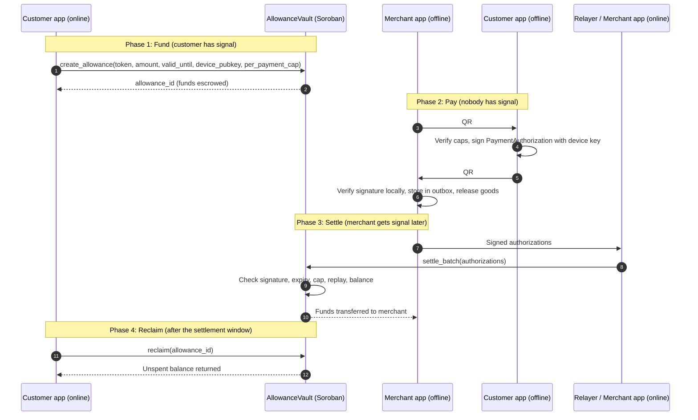
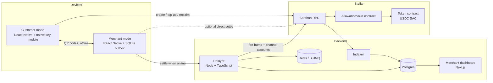

# Kasuwa

**Offline-first payments on Stellar Soroban. Pay with no signal, settle when you reconnect.**

> *Kasuwa* is the Hausa word for "market". This project exists so that a market stall, a roadside vendor, or a village shop can accept digital money even when the nearest cell tower is out of reach.

[](./LICENSE)
[](#project-status)
[](#project-status)


---

## Table of contents

1. [What is Kasuwa?](#what-is-kasuwa)
2. [The problem](#the-problem)
3. [How it works](#how-it-works)
4. [Core design principles](#core-design-principles)
5. [Security model and threat analysis](#security-model-and-threat-analysis)
6. [System architecture](#system-architecture)
7. [Smart contract specification](#smart-contract-specification)
8. [Payment protocol specification](#payment-protocol-specification)
9. [Monorepo structure](#monorepo-structure)
10. [Tech stack](#tech-stack)
11. [Getting started](#getting-started)
12. [Configuration](#configuration)
13. [Development workflow](#development-workflow)
14. [Testing strategy](#testing-strategy)
15. [Deployment](#deployment)
16. [Merchant risk policy](#merchant-risk-policy)
17. [Cash in and cash out](#cash-in-and-cash-out)
18. [Roadmap](#roadmap)
19. [Project status](#project-status)
20. [Contributing](#contributing)
21. [Security](#security)
22. [FAQ](#faq)
23. [License](#license)

---

## What is Kasuwa?

Kasuwa lets a **customer with no internet connection** pay a **merchant who also has no internet connection**, using two phones and nothing but the camera.

1. The customer locks a small prefunded **offline allowance** in a Soroban smart contract while they still have connectivity.
2. At the point of sale, the merchant shows a **payment request QR code**.
3. The customer's phone scans it and produces a **signed, expiring payment authorization**, displayed as a second QR code.
4. The merchant scans that QR code, verifies the signature locally, and hands over the goods.
5. Later, whenever the merchant gets a connection, the app **settles** the authorization on-chain. The contract checks the signature, expiry, amount cap, and replay protection, then moves funds from the escrowed allowance to the merchant.

No Bluetooth pairing, no NFC requirement, no SMS gateway, and no trusted third party in the payment path.

## The problem

Mobile money and card networks assume the network is up at the moment of payment. In large parts of the world, that assumption fails:

- Rural markets with intermittent or no coverage
- Network outages, congestion, and load-shedding
- Data costs that make "always online" unaffordable
- Basements, transit, festivals, and disaster zones

Where connectivity is the barrier, cash wins by default, even when people would prefer a digital option. Kasuwa removes the requirement that **both parties be online at the moment of sale**.

## How it works

### The honest framing: bound, don't prevent

A fully offline system **cannot prevent double-spending**. Two merchants who are both offline can both accept the same funds from the same customer, and neither can know about the other.

Kasuwa instead:

- **Bounds** the loss with a prefunded, escrowed allowance and a per-payment cap
- **Attributes** every overspend to a specific device key on-chain
- **Prices** the residual risk so merchants can decide, at the counter, how much they are willing to accept offline

### End-to-end flow



### Lifecycle of an allowance

```
Created ──► Active ──► (valid_until passes) ──► Settling window ──► Reclaimable ──► Closed
              │                                                         ▲
              └── request_close() ── (max payment TTL + grace) ─────────┘
```

---

## Core design principles

| Principle | What it means in practice |
|---|---|
| **Offline-first** | Neither side needs a network at the moment of payment. All verification that can happen locally, does. |
| **Bounded risk** | Every payment is backed by escrowed funds. The worst case for a merchant is a partial payment, never a payment with nothing behind it. |
| **Non-custodial** | Funds sit in a contract, not with Kasuwa. The relayer can submit transactions but cannot move funds anywhere except to the merchant named in a valid signature. |
| **Hardware-backed keys** | The signing key lives in the Secure Enclave (iOS) or Android Keystore / StrongBox. It cannot be exported. |
| **Tiny payloads** | Authorizations fit in a single, low-density QR code that cheap cameras can scan quickly. |
| **Permissionless settlement** | Anyone can submit a valid authorization. The merchant does not depend on our relayer being up. |
| **Explicit expiry** | Every authorization is time-limited and every allowance has a hard end. Nothing lives forever. |

---

## Security model and threat analysis

### Trust assumptions

- The customer's **device key is hardware-protected** and unlocked by biometrics or device PIN.
- The Stellar network and Soroban host functions behave as documented.
- Clocks on phones are roughly correct. Wrong clocks only hurt the party holding the wrong clock (see below).

### Threats and mitigations

| # | Threat | Mitigation |
|---|---|---|
| T1 | **Customer double-spends offline** to two merchants | Spend is capped by the escrowed allowance. First settlement wins; later settlements are partially paid or rejected. The shortfall is recorded on-chain against the device key. Merchant policy limits exposure per sale. |
| T2 | **Replay** of a captured authorization | Each authorization has a random 128-bit `payment_id`. The contract stores used IDs per allowance and rejects duplicates. |
| T3 | **Cross-contract or cross-network replay** (e.g. testnet to mainnet) | `contract_id` and `network_id` are included in the signed message under a domain-separation tag. |
| T4 | **QR theft**: someone photographs the customer's QR | The authorization is bound to a specific `merchant` address. Only that merchant receives funds. |
| T5 | **Merchant tampers with amount** | Amount is inside the signed message. Any change invalidates the signature. |
| T6 | **Customer withdraws funds before merchant settles** | No instant withdrawal. `reclaim` is only possible after `valid_until + max_payment_ttl + grace`, which guarantees every legitimately issued authorization can still settle. |
| T7 | **Customer backdates or forward-dates `issued_at`** | Contract rejects `issued_at > valid_until` and `expires_at - issued_at > max_payment_ttl`. Backdating only makes the authorization expire sooner, which hurts only the customer. |
| T8 | **Lost or stolen phone** | Hardware key plus biometric gate. Customer can call `request_close`, which freezes new top-ups and starts the reclaim countdown. Per-payment caps and small allowances limit exposure. |
| T9 | **Merchant loses the phone before settling** | Authorizations are exportable. The outbox can be backed up when online. Unsettled authorizations remain valid until their expiry. |
| T10 | **Relayer censorship or downtime** | Settlement is permissionless. The merchant app can submit directly, or any other relayer can. |
| T11 | **Malleable ECDSA signatures** (secp256r1) | Contract enforces low-S normalization; clients normalize before display. |
| T12 | **Griefing**: spam of invalid settlements | Relayer pre-validates and rate-limits. On-chain, invalid items in a batch return result codes rather than reverting the entire batch. |

### What Kasuwa cannot protect against

- A determined, well-resourced attacker with a rooted device and an extraction exploit for hardware key stores
- A customer deliberately running a coordinated overspend across many merchants within the cap of their allowance (this is the bounded loss the system accepts)
- Merchants who ignore their own risk policy

Please read the [FAQ](#faq) for more.

---

## System architecture



### Components

| Component | Responsibility |
|---|---|
| **Mobile app** | One app, two modes. Customer mode: manage allowances, scan requests, sign and display authorizations. Merchant mode: create requests, scan authorizations, verify locally, keep an outbox, sync and settle. |
| **Vault contract** | Escrow, signature verification, expiry, caps, replay protection, partial settlement, dispute records, reclaim. |
| **Relayer** | Receives signed authorizations, pre-validates them, submits `settle_batch` using channel accounts, and wraps transactions in fee-bumps so merchants never need XLM. |
| **Indexer** | Streams contract events into Postgres for history, dashboards, and merchant risk-cache snapshots. Needed because RPC event retention is limited. |
| **Dashboard** | Reconciliation, exports, settlement status, dispute view. |
| **Protocol package** | Single source of truth for payload encoding, hashing, and message construction, used by apps, relayer, and tests. |

---

## Smart contract specification

> The interface below is the **target design**. Treat the code in `contracts/allowance-vault` as authoritative once it exists.

### Types

```rust
pub struct Allowance {
    pub owner: Address,
    pub token: Address,
    pub device_key: BytesN<65>,     // uncompressed secp256r1 public key
    pub balance: i128,              // remaining, unspent
    pub per_payment_cap: i128,
    pub valid_until: u64,           // unix seconds; no new payments issued after this
    pub close_requested_at: Option<u64>,
    pub status: Status,             // Active | Closing | Closed
}

pub struct PaymentAuth {
    pub version: u8,
    pub allowance_id: u64,
    pub payment_id: BytesN<16>,
    pub merchant: Address,
    pub amount: i128,
    pub issued_at: u64,
    pub expires_at: u64,
}

pub enum SettleResult {
    Settled,
    Partial(i128 /* paid */, i128 /* shortfall */),
    Rejected(RejectReason),
}

pub enum RejectReason {
    BadSignature, Expired, OverCap, Replay,
    UnknownAllowance, WrongMerchant, BadWindow, Insufficient,
}
```

### Functions

| Function | Caller | Description |
|---|---|---|
| `initialize(admin, max_payment_ttl, grace_period, min_allowance, max_allowance)` | Deployer | One-time setup of protocol parameters. |
| `create_allowance(owner, token, amount, valid_until, device_key, per_payment_cap) -> allowance_id` | Customer (auth required) | Transfers `amount` from the owner into escrow and registers the device key. |
| `top_up(allowance_id, amount)` | Owner | Adds funds. Does not shorten any window. |
| `settle(auth, signature) -> SettleResult` | Anyone | Verifies and pays out one authorization. |
| `settle_batch(Vec<(PaymentAuth, BytesN<64>)>) -> Vec<SettleResult>` | Anyone | Same as `settle`, per-item result codes, no batch-wide revert on a bad item. |
| `request_close(allowance_id)` | Owner | Stops new top-ups and starts the reclaim countdown early (for lost phones). |
| `reclaim(allowance_id)` | Owner | Returns the unspent balance. Only after the settlement window. |
| `get_allowance(id)` / `get_shortfalls(device_key)` | Anyone | Read-only views. |
| `extend_ttl(allowance_id)` | Anyone | Keeps persistent storage entries alive. |

### Invariants (enforced and property-tested)

1. `sum(settled) + balance + reclaimed == sum(deposited)` for every allowance.
2. A `payment_id` can be settled at most once per allowance.
3. Funds can only move to the `merchant` named inside a valid signature, or back to the `owner`.
4. `reclaim` is impossible before `max(valid_until, close_requested_at) + max_payment_ttl + grace`.
5. A single payment never exceeds `per_payment_cap`.
6. No path lets the admin move escrowed funds.

### Signature verification notes

- The signed message is `SHA-256(domain_tag || canonical_bytes(PaymentAuth) || contract_id || network_id)`.
- Verification uses Soroban's secp256r1 host function so keys can live in the Secure Enclave and Android Keystore. **Verify the exact host function signature and availability against the current Soroban docs before implementing.**
- Mobile key stores often return **DER-encoded** signatures. The protocol package converts these to the raw 64-byte `r || s` form and **normalizes to low-S** before display.

### Storage and rent

- `Allowance` records and `used_payment_ids` live in **persistent storage** with TTL extension on every touch.
- Used IDs for an allowance can safely expire once `valid_until + max_payment_ttl` has passed, since later authorizations would be rejected anyway.
- A small rent budget is part of the allowance creation fee. See `docs/storage-and-rent.md`.

---

## Payment protocol specification

### Step 1: Payment request (merchant → customer QR)

The customer's phone needs to know *who* it is paying and *how much*, so the merchant displays a request first.

```
PaymentRequest {
  version:      u8
  merchant:     32 bytes   (account or contract address, raw form)
  amount:       varint     (in token base units)
  token_hint:   u8         (index into an app-known token list)
  request_id:   8 bytes    (random, merchant's invoice reference)
  expires_at:   u32        (short, e.g. 10 minutes)
}
```

### Step 2: Payment authorization (customer → merchant QR)

```
PaymentAuthorization {
  version:       u8
  allowance_id:  u64
  payment_id:    16 bytes   (random)
  merchant:      32 bytes
  amount:        varint
  issued_at:     u40
  expires_at:    u40
  signature:     64 bytes   (secp256r1, raw r||s, low-S)
}
```

- Encoded as compact binary (fixed layout or CBOR), then base64url. Roughly **190 bytes**, well within a single scannable QR code at medium error correction.
- `contract_id` and `network_id` are **not** transmitted. Both sides know them from app configuration, and they are mixed into the signed message.
- Merchants verify offline: signature, `merchant == self`, `amount == requested`, `expires_at` in the future, and `payment_id` not already in the local outbox.

### Why two QR codes?

The authorization must be bound to a single merchant (threat T4). That requires the customer's phone to learn the merchant identity and amount first. A one-way "customer shows QR" scheme would let anyone who photographs it redirect the funds.

### Future transports

The protocol is transport-agnostic. NFC and Bluetooth LE are planned as faster alternatives that carry the same bytes.

---

## Monorepo structure

Kasuwa is a single repository with a **pnpm + Turborepo** workspace for TypeScript and a **Cargo workspace** for Rust.

```
kasuwa/
├── apps/
│   ├── mobile/                 # Expo (React Native) app: customer + merchant modes
│   │   ├── src/
│   │   │   ├── features/
│   │   │   │   ├── allowance/  # create, top up, reclaim
│   │   │   │   ├── pay/        # scan request, sign, show authorization QR
│   │   │   │   ├── receive/    # create request, scan authorization, verify
│   │   │   │   └── outbox/     # offline queue, sync, settlement status
│   │   │   ├── native/         # key-store bridge (Secure Enclave / Keystore)
│   │   │   └── db/             # SQLite schema and migrations
│   │   └── app.config.ts
│   ├── relayer/                # Node + TS: settlement API, fee-bump, channel accounts
│   ├── indexer/                # Contract event ingestion into Postgres
│   └── dashboard/              # Next.js merchant dashboard
│
├── contracts/                  # Cargo workspace
│   ├── Cargo.toml
│   ├── allowance-vault/        # The main Soroban contract
│   │   ├── src/
│   │   │   ├── lib.rs
│   │   │   ├── types.rs
│   │   │   ├── storage.rs
│   │   │   ├── verify.rs
│   │   │   └── test/
│   │   └── Cargo.toml
│   └── test-token/             # Minimal token for local tests
│
├── packages/
│   ├── protocol/               # Payload codecs, message hashing, test vectors (TS)
│   ├── sdk/                    # Typed contract client (generated bindings + helpers)
│   ├── risk/                   # Merchant acceptance policy engine
│   ├── db/                     # Postgres schema and migrations (relayer + indexer)
│   ├── ui/                     # Shared UI components
│   └── config/                 # Shared tsconfig, eslint, prettier
│
├── test-vectors/               # Language-neutral protocol vectors (JSON)
│   └── payment-auth.json       # Used by Rust, TS, and native tests
│
├── infra/
│   ├── docker/                 # Local stack: Quickstart, Postgres, Redis
│   ├── terraform/              # Cloud infrastructure (optional)
│   └── kms/                    # Relayer key management notes and policies
│
├── docs/
│   ├── architecture.md
│   ├── protocol.md
│   ├── threat-model.md
│   ├── storage-and-rent.md
│   ├── merchant-risk-policy.md
│   └── adr/                    # Architecture decision records
│
├── scripts/                    # Deploy, seed, demo helpers
├── .github/workflows/          # CI
├── Cargo.toml                  # (re-exports contracts workspace)
├── package.json
├── pnpm-workspace.yaml
├── turbo.json
├── LICENSE
└── README.md
```

### Why a monorepo here

- **One protocol, many implementers.** The contract, the mobile signer, the merchant verifier, and the relayer all depend on byte-exact message encoding. Keeping `test-vectors/` at the root means a change to the format fails CI in **every** consumer at once.
- **Atomic changes.** A contract interface change and its SDK, relayer, and app updates land in the same pull request.
- **Shared tooling.** One lint config, one CI pipeline, one release process.

---

## Tech stack

| Layer | Choice | Notes |
|---|---|---|
| Smart contracts | Rust, `soroban-sdk`, Stellar CLI | Compiled to WASM. Tests use the SDK's test environment. |
| Token | USDC or another stablecoin via the Stellar Asset Contract | Standard token interface. |
| Signatures | secp256r1 (hardware-backed), via Soroban host functions | ed25519 fallback for dev and Android devices without suitable key stores. |
| Mobile | React Native with Expo (custom dev client) | Native modules for Secure Enclave / Keystore. May move to fully native for customer signing if library limits bite. |
| QR | `react-native-qrcode-svg`, `react-native-vision-camera` | Compact binary payloads. |
| Local storage (mobile) | SQLite (`expo-sqlite`) | Outbox, caches, receipts. |
| Chain access | `@stellar/stellar-sdk`, Soroban RPC | Transaction building, simulation, submission. |
| Relayer | Node.js, TypeScript, Fastify | Fee-bump, channel accounts, retries. |
| Queue | Redis, BullMQ | Parallel settlement and retry. |
| Database | PostgreSQL | Settlement records, events, disputes. |
| Dashboard | Next.js | Merchant reconciliation. |
| Monorepo tooling | pnpm, Turborepo, Cargo workspace | Cached builds and tests. |
| CI | GitHub Actions | `cargo test`, `clippy`, `pnpm test`, lint, build. |
| Monitoring | Sentry, Prometheus-compatible metrics | Alerts on relayer balance and failed settlements. |

---

## Getting started

### Prerequisites

| Tool | Version | Purpose |
|---|---|---|
| Node.js | 20 LTS or newer | TypeScript apps and packages |
| pnpm | 9+ | Workspace package manager |
| Rust | stable, with `wasm32v1-none` or `wasm32-unknown-unknown` target | Contract build (check the current Soroban docs for the right target) |
| Stellar CLI | latest | Build, deploy, key management, bindings |
| Docker | recent | Local Stellar network, Postgres, Redis |
| Xcode / Android Studio | latest | Mobile builds |

### 1. Clone and install

```bash
git clone https://github.com/<your-org>/kasuwa.git
cd kasuwa
pnpm install
```

### 2. Add the Rust target and install the Stellar CLI

```bash
rustup target add wasm32v1-none    # or wasm32-unknown-unknown, per current docs
cargo install --locked stellar-cli
```

### 3. Start the local stack

```bash
pnpm infra:up
```

This starts, via Docker Compose: a local Stellar network (Quickstart image) with Soroban RPC, Postgres, and Redis.

### 4. Build and test the contracts

```bash
cd contracts
cargo test
stellar contract build
```

### 5. Deploy locally

```bash
pnpm contracts:deploy:local
```

This script generates funded local identities, deploys a test token and the `allowance-vault`, initializes protocol parameters, and writes addresses to `.env.local`.

### 6. Generate typed bindings

```bash
pnpm sdk:generate
```

Wraps `stellar contract bindings typescript` and drops the output into `packages/sdk`.

### 7. Run the backend services

```bash
pnpm --filter relayer dev
pnpm --filter indexer dev
pnpm --filter dashboard dev
```

### 8. Run the mobile app

```bash
cd apps/mobile
pnpm expo prebuild
pnpm expo run:android     # or run:ios
```

Because the app uses native key-store modules, **Expo Go will not work**. Use a development build.

### 9. Try the offline demo

1. Install the app on **two** phones (or one phone and one emulator).
2. Phone A: **Customer mode** → create an allowance (e.g. 10 test USDC).
3. Put **both phones in airplane mode**.
4. Phone B: **Merchant mode** → new request → enter an amount.
5. Phone A: scan the request → confirm with biometrics → show the authorization QR.
6. Phone B: scan it. A "Verified offline ✓" screen appears and the payment sits in the outbox.
7. Turn networking back on for Phone B. The outbox settles and the balance updates.

---

## Configuration

Environment variables are loaded from `.env.local` at the repo root and per-app `.env` files. Never commit secrets.

| Variable | Used by | Description |
|---|---|---|
| `STELLAR_NETWORK` | all | `local`, `testnet`, or `mainnet` |
| `STELLAR_NETWORK_PASSPHRASE` | all | Network passphrase (also feeds `network_id`) |
| `SOROBAN_RPC_URL` | relayer, indexer, mobile | RPC endpoint |
| `VAULT_CONTRACT_ID` | all | Deployed `allowance-vault` address |
| `TOKEN_CONTRACT_ID` | all | Default token (e.g. USDC SAC) |
| `RELAYER_KMS_KEY_ID` | relayer | KMS key reference for the fee-payer identity |
| `RELAYER_CHANNEL_ACCOUNTS` | relayer | Number of channel accounts for parallel submission |
| `DATABASE_URL` | relayer, indexer, dashboard | Postgres connection string |
| `REDIS_URL` | relayer | Queue backend |
| `RELAYER_API_KEYS` | relayer | Allowed client keys (rate-limited) |
| `SENTRY_DSN` | all | Error reporting |
| `EXPO_PUBLIC_*` | mobile | Public configuration only; never secrets |

---

## Development workflow

### Common commands

```bash
pnpm dev               # run all apps in watch mode (where applicable)
pnpm build             # build everything (Turborepo-cached)
pnpm lint              # eslint + prettier + cargo clippy + cargo fmt --check
pnpm test              # TS tests + cargo test
pnpm test:vectors      # cross-language protocol test vectors only
pnpm contracts:build   # stellar contract build
pnpm contracts:deploy:testnet
pnpm sdk:generate      # regenerate typed contract bindings
pnpm infra:up          # start local stack
pnpm infra:down
```

### Branching and commits

- `main` is always releasable. Work happens on short-lived feature branches.
- Conventional Commits (`feat:`, `fix:`, `docs:`, `chore:`), enforced by commitlint.
- Any change to `PaymentAuth` encoding must update `test-vectors/` and include an ADR in `docs/adr/`.

### Changing the protocol

1. Edit the spec in `docs/protocol.md`.
2. Update `test-vectors/payment-auth.json`.
3. Update Rust (`contracts/allowance-vault`) and TS (`packages/protocol`) until `pnpm test:vectors` is green in both.
4. Bump the protocol `version` byte if the change is not backwards compatible.

---

## Testing strategy

| Level | Tooling | What it covers |
|---|---|---|
| **Contract unit tests** | `cargo test`, Soroban test env | Each function, auth, expiry boundaries, replay, caps, partial settlement, reclaim windows |
| **Property tests** | `proptest` | Conservation of funds, no double settlement, window invariants across random sequences |
| **Protocol vectors** | JSON vectors shared by Rust, TS, and native | Byte-exact encoding and hashing, DER→raw signature conversion, low-S normalization |
| **Integration tests** | Vitest + local Quickstart network | Full create → sign → settle → reclaim flows through the real RPC |
| **Relayer tests** | Vitest + Testcontainers | Queueing, retries, fee-bump behavior, idempotency |
| **Mobile unit tests** | Jest | Outbox state machine, risk policy, QR encode/decode |
| **Mobile E2E** | Detox or Maestro | Airplane-mode flows between two simulators |
| **Fuzzing** | `cargo-fuzz` on decoders | Malformed payloads never panic or mis-parse |
| **Chaos / field testing** | Manual and scripted | Clock skew, killed apps mid-settlement, flaky connectivity, low-end Android devices |

### Coverage expectations

- Contracts: every `Reject` path has a dedicated test.
- Protocol: every field has a boundary vector (min, max, off-by-one).

---

## Deployment

### Contracts

```bash
stellar contract build
stellar contract deploy \
  --wasm target/wasm32v1-none/release/allowance_vault.wasm \
  --source <deployer-identity> \
  --network testnet
```

- Deploy to **testnet** first. Mainnet deployment requires a completed audit, a published parameter set, and a documented upgrade policy.
- Decide early whether the contract is **immutable** or upgradeable. If upgradeable, upgrades must be behind a timelock and a multisig, and must never be able to touch escrowed balances. Document this in an ADR.

### Relayer and indexer

- Containerized (`apps/relayer/Dockerfile`) and deployable on any container platform.
- Relayer signing keys live in a **KMS**, never in plain environment variables.
- Monitor: relayer fee-payer balance, channel account health, queue depth, failed settlement rate, RPC latency.

### Mobile

- Android: Play Store plus direct APK distribution (important for markets with limited store access).
- iOS: TestFlight, then App Store.
- Target low-end Android hardware in CI performance budgets (cold start, QR scan latency).

---

## Merchant risk policy

Because merchants cannot see on-chain state at the moment of sale, the `packages/risk` engine gives them guard rails that run entirely offline:

- **Allowance snapshot cache.** When online, the merchant app syncs known allowance data (owner, size, age, history of shortfalls) from the indexer. At the counter, it looks up the allowance by ID.
- **Tiered limits.** For example: accept up to X with an unknown allowance, Y with a known, aged allowance, Z for a customer with a clean history.
- **Exposure tracking.** The app tracks total unsettled authorizations per allowance. If three merchants nearby each accept $15 against a $20 allowance, the *next* one sees the cumulative risk (merchant-local view only).
- **Warnings, not blocks.** The merchant is always the decision-maker. The app shows green / amber / red.
- **Auto-settle.** Settle as soon as any connection appears, to shrink the double-spend window.

Policies are configurable per merchant and documented in `docs/merchant-risk-policy.md`.

---

## Cash in and cash out

Offline payments only matter if people can get money in and out. Kasuwa is designed to plug into:

- **Stellar anchors** (SEP-10 authentication, SEP-24 interactive deposit and withdrawal) for fiat on and off ramps
- **Local agent networks** where people deposit cash with an agent and receive stablecoin in their wallet
- **Merchant cash-out** at an agent or via an anchor, using the dashboard's settlement reports

Partnerships on the ground matter more than code here, and the roadmap reflects that.

---

## Roadmap

### Phase 0: Foundations
- [ ] Monorepo scaffolding, CI, lint, formatting
- [ ] Protocol spec v1 and shared test vectors
- [ ] `allowance-vault` contract with unit and property tests
- [ ] Local deploy scripts and typed SDK

### Phase 1: Working demo
- [ ] Mobile app: customer and merchant modes
- [ ] Hardware-backed signing on iOS and Android
- [ ] Two-QR offline flow with local verification
- [ ] SQLite outbox and manual settlement
- [ ] Testnet deployment and public demo video

### Phase 2: Production plumbing
- [ ] Relayer with channel accounts and fee-bump sponsorship
- [ ] Indexer and merchant dashboard
- [ ] Merchant risk engine and allowance snapshot sync
- [ ] On-chain shortfall and dispute records
- [ ] Observability and alerting

### Phase 3: Hardening and pilot
- [ ] Third-party security audit of contracts and key handling
- [ ] Threat-model review and bug bounty
- [ ] Anchor integration for cash in and out
- [ ] Field pilot with real merchants in a low-connectivity market
- [ ] Localization (including Hausa, Yoruba, Igbo, Swahili, French) and low-literacy UX

### Phase 4: Scale and extensions
- [ ] NFC and Bluetooth LE transports
- [ ] Multi-token allowances
- [ ] Merchant-to-merchant offline payments
- [ ] Optional passkey / WebAuthn-based signing
- [ ] Mainnet launch

---

## Project status

| Area | Status |
|---|---|
| Protocol spec | 🟡 Draft |
| Contracts | 🟡 In design |
| Mobile app | ⚪ Not started |
| Relayer / indexer | ⚪ Not started |
| Audit | ⚪ Not started |
| Mainnet | ⚪ Not yet |

Everything here is subject to change. Interfaces and the wire format are **not stable** until Protocol v1 is tagged.

---

## Contributing

Contributions are welcome. A few ways to help:

- **Review the protocol and threat model.** Adversarial thinking is the most valuable contribution right now.
- **Contracts:** tests, property tests, gas and storage optimization.
- **Mobile:** native key-store modules, low-end Android performance, accessibility.
- **Field research:** insights from merchants and customers in low-connectivity markets.
- **Docs and translations.**

### Process

1. Open an issue to discuss significant changes before starting.
2. Fork, branch, and make your change with tests.
3. Run `pnpm lint && pnpm test` locally.
4. Open a pull request. Link the issue, and describe behavior changes and any protocol impact.

By contributing, you agree that your contributions are licensed under the project license. See `CONTRIBUTING.md` and `CODE_OF_CONDUCT.md`.

---

## Security

This project handles value and cryptographic keys. If you find a vulnerability:

- **Do not open a public issue.**
- Email **security@your-domain.example** (replace with a real address) with details and reproduction steps.
- We aim to acknowledge within 72 hours.

A bug bounty will be announced ahead of the mainnet launch. Until the audit is complete, treat all deployments as experimental.

---

## FAQ

**Can this really prevent double-spending offline?**
No, and no offline system can. Kasuwa bounds the loss through escrow, per-payment caps, and merchant-side policy, and attributes any overspend to a device key. See [How it works](#how-it-works).

**What happens if a customer overspends?**
The first authorizations to settle are paid in full. Later ones are paid partially or rejected once the allowance is exhausted. The shortfall is recorded on-chain against the device key, which can feed reputation or collateral requirements for future allowances.

**Does the merchant need XLM or any crypto knowledge?**
No. The relayer sponsors fees. Merchants see amounts in familiar currency terms, and settle automatically in the background.

**What if the merchant's phone dies before it settles?**
Authorizations stay valid until their expiry. The outbox can be backed up while online, and restored on a new device. Keep expiry generous (24–72 hours is typical) for this reason.

**Why not use Soroban's native pre-signed authorization entries?**
They work, but they are larger, expressed in ledger numbers rather than wall-clock time, and fiddly to build without network access. A compact custom message gives smaller QR codes and tighter control. This is recorded in an ADR and may be revisited.

**Why secp256r1 instead of ed25519?**
Because iOS Secure Enclave and Android Keystore natively support P-256, not ed25519. Hardware-backed, non-exportable keys are a core security property.

**Why two QR codes instead of one?**
To bind the payment to a specific merchant and prevent QR theft. See [Why two QR codes](#why-two-qr-codes).

**What about regulation?**
Rules for stablecoins, e-money, and payments vary by country. Anyone operating Kasuwa as a service (especially cash in and out) is responsible for local licensing and KYC/AML compliance. This repository provides software, not legal advice.

**Is it custodial?**
No. Funds are held by the contract and can only move to the merchant named in a valid signature, or back to the owner after the settlement window.

---

## License

Licensed under the [Apache License, Version 2.0](./LICENSE).

---

## Acknowledgements

- The [Stellar Development Foundation](https://stellar.org) and the Soroban community for the smart contract platform
- The teams building passkey, WebAuthn, and hardware-backed key standards
- Everyone building payments for places where the network is the hard part

---

<p align="center"><i>Built for the market, not just the network.</i></p>
