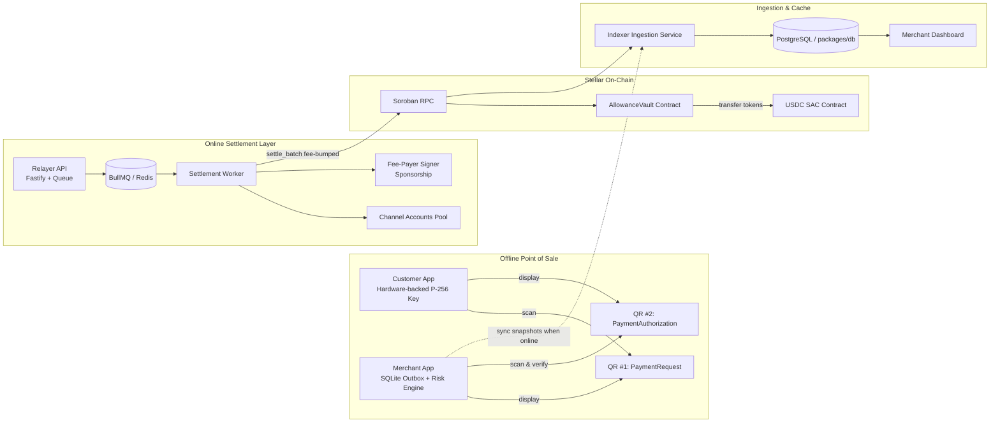

# Kasuwa System Architecture

Kasuwa is an offline-first payment system on Stellar Soroban designed to bound and attribute double-spend risk without requiring internet connectivity at the point of sale.

---

## Architecture Diagram

---

## Allowance Snapshot Balance Bucketing: Privacy Tradeoff

### The Privacy Problem

When merchants accept payments offline, they evaluate risk using cached allowance snapshots synced earlier from the indexer (`GET /v1/snapshots`).

If the snapshot feed exposed **exact on-chain balances** (e.g. `14.32 USDC`), every merchant visited by a customer would learn:
1. Exactly how much money the customer holds in total.
2. Changes in the customer's balance between visits, allowing merchants to infer other purchases and transactions.
3. Financial profiling of customers based on exact balances.

### Coarse Bucketing Solution

To protect customer privacy while preserving risk evaluation utility, the Kasuwa Indexer coarsens balances into **coarse balance buckets**:

| Bucket | Base Units (USDC) | Meaning for Risk Engine |
|---|---|---|
| `0` | 0 | Depleted allowance (warn/refuse) |
| `1-10` | 1 .. 10,000,000 | Micro allowance |
| `10-50` | 10,000,001 .. 50,000,000 | Small allowance (typical retail) |
| `50-200` | 50,000,001 .. 200,000,000 | Medium allowance |
| `200+` | > 200,000,000 | Large allowance |

### The Security & Privacy Balance

- **Privacy Gain**: Merchants cannot distinguish between a customer with $11 and $49 remaining. No merchant learns exact balances or itemized spend totals.
- **Risk Acceptability**: The merchant's offline risk policy is based on tiered limits and exposure bounds (e.g. accepting up to $15 offline for a known active allowance). A coarse bucket provides sufficient signal that funds exist and escrow is non-empty without leaking precision.
