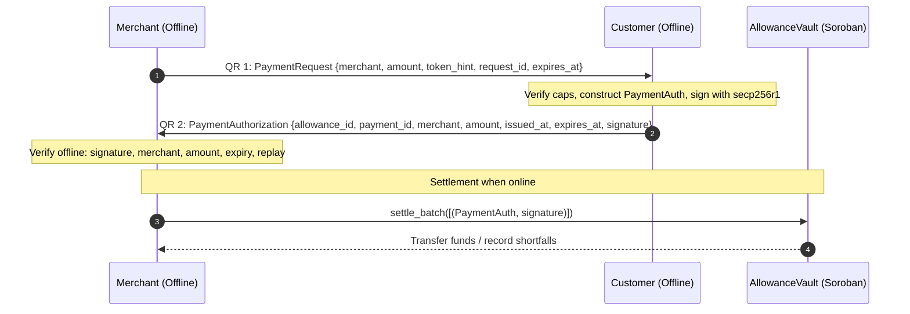

# Kasuwa Payment Protocol Specification (Protocol Version 1)

This document is the normative wire format, cryptographic hashing, and validation specification for **Protocol Version 1** of Kasuwa.

---

## 1. Protocol Architecture & Flow

Kasuwa enables offline transactions using a two-QR handshake between a merchant and a customer device, followed by asynchronous on-chain settlement:

1. **Step 1: Payment Request (Merchant → Customer)**  
   The merchant generates and displays a `PaymentRequest` QR code encoding the recipient address, amount, request reference, and expiry.
2. **Step 2: Payment Authorization (Customer → Merchant)**  
   The customer scans the request, checks local limits, signs a canonical `PaymentAuth` with their hardware-backed private key (`secp256r1`), and displays a `PaymentAuthorization` QR code.
3. **Step 3: Offline Verification & Handover**  
   The merchant scans the authorization, validates the signature, recipient match, amount match, and expiry locally, stores the payload in their local SQLite outbox, and releases the goods.
4. **Step 4: Asynchronous Settlement**  
   When the merchant reconnects to the internet, authorizations are submitted to the `AllowanceVault` Soroban contract via `settle` or `settle_batch`.



---

## 2. Wire Format Specification

### 2.1 Varint Encoding Rules

Integers designated as `varint` are encoded using unsigned **LEB128** (Little-Endian Base 128):
- Each byte contains 7 bits of value payload (bits 0–6).
- Bit 7 (most significant bit) is the continuation flag: `1` indicates more bytes follow; `0` indicates the terminal byte.
- Values are encoded in little-endian order (least significant 7-bit group first).
- **Canonical encoding rule**: Overlong encodings (trailing zero payload bytes with continuation bits) are strictly forbidden and MUST be rejected by decoders.
- Maximum decoded value for token amounts: unsigned 64-bit integer (`0 <= amount <= 2^64 - 1`), occupying at most 10 bytes.

### 2.2 PaymentRequest Binary Layout

The `PaymentRequest` payload is a binary structure with the following exact field order and byte layout:

| Field | Type | Width (bytes) | Encoding / Endianness | Description |
|---|---|---|---|---|
| `version` | `u8` | 1 | Unsigned 8-bit (`0x01`) | Protocol version identifier |
| `merchant` | `bytes32` | 32 | Raw byte array | Merchant Stellar account public key or contract address |
| `amount` | `varint` | 1–10 | Unsigned LEB128 | Amount in token base units (e.g. 7 decimal places for USDC) |
| `token_hint` | `u8` | 1 | Unsigned 8-bit | Index into app-known token registry (`0` = USDC SAC) |
| `request_id` | `bytes8` | 8 | Raw byte array | Random invoice / order identifier generated by merchant |
| `expires_at` | `u32` | 4 | Big-endian unsigned 32-bit | Unix timestamp (seconds) after which request expires |

- **Minimum Size**: $1 + 32 + 1 + 1 + 8 + 4 = 47$ bytes (for amounts $< 128$).
- **Maximum Size**: $1 + 32 + 10 + 1 + 8 + 4 = 56$ bytes.

### 2.3 PaymentAuthorization Binary Layout

The `PaymentAuthorization` payload is transmitted from customer to merchant:

| Field | Type | Width (bytes) | Encoding / Endianness | Description |
|---|---|---|---|---|
| `version` | `u8` | 1 | Unsigned 8-bit (`0x01`) | Protocol version identifier |
| `allowance_id` | `u64` | 8 | Big-endian unsigned 64-bit | On-chain ID of customer's funded allowance |
| `payment_id` | `bytes16` | 16 | Raw byte array | Random unique 128-bit payment identifier |
| `merchant` | `bytes32` | 32 | Raw byte array | Merchant Stellar account or contract ID |
| `amount` | `varint` | 1–10 | Unsigned LEB128 | Amount in token base units |
| `issued_at` | `u40` | 5 | Big-endian unsigned 40-bit | Unix timestamp (seconds) when payment was authorized |
| `expires_at` | `u40` | 5 | Big-endian unsigned 40-bit | Unix timestamp (seconds) when authorization expires |
| `signature` | `bytes64` | 64 | Raw `r \|\| s` | Low-S normalized secp256r1 signature |

- **Minimum Size**: $1 + 8 + 16 + 32 + 1 + 5 + 5 + 64 = 132$ bytes.
- **Maximum Size**: $1 + 8 + 16 + 32 + 10 + 5 + 5 + 64 = 141$ bytes.

### 2.4 PaymentAuth Canonical Bytes

`PaymentAuth` represents the unsigned message structure. Its canonical byte serialization is defined as the exact prefix of `PaymentAuthorization` excluding the terminal 64-byte `signature`:

$$\text{canonical\_bytes}(PaymentAuth) = PaymentAuthorization[0 \dots (\text{len} - 65)]$$

Field order:
1. `version` (1 byte, `u8`)
2. `allowance_id` (8 bytes, `u64` BE)
3. `payment_id` (16 bytes, raw)
4. `merchant` (32 bytes, raw)
5. `amount` (1–10 bytes, unsigned LEB128 varint)
6. `issued_at` (5 bytes, `u40` BE)
7. `expires_at` (5 bytes, `u40` BE)

Total length of `canonical_bytes(PaymentAuth)`: 68 to 77 bytes.

---

## 3. Cryptographic Hashing & Signing

### 3.1 Domain Separation & Signed Message Construction

To prevent cross-network and cross-contract signature re-use, signatures are computed over a 32-byte SHA-256 digest constructed with strict domain separation:

$$\text{digest} = \text{SHA-256}(\text{domain\_tag} \parallel \text{canonical\_bytes}(PaymentAuth) \parallel \text{contract\_id} \parallel \text{network\_id})$$

Where:
- **`domain_tag`**: The 22-byte ASCII string:
  ```
  kasuwa-v1:payment-auth
  ```
  (Hex: `6b61737577612d76313a7061796d656e742d61757468`).
- **`canonical_bytes(PaymentAuth)`**: The exact canonical serialization defined in Section 2.4.
- **`contract_id`**: 32-byte raw identifier of the deployed `AllowanceVault` contract.
- **`network_id`**: 32-byte SHA-256 hash of the Stellar network passphrase:
  $$\text{network\_id} = \text{SHA-256}(\text{network\_passphrase})$$
  - Mainnet: `SHA-256("Public Global Stellar Network ; September 2015")` = `7ac3399524709470d07d7d4ff993fe475c581fa9ac9992e0075481b7ac204b88`
  - Testnet: `SHA-256("Test SDF Network ; September 2015")` = `cee0302d59844d32bdca915c8203dd5b661bd778810dd4bad92f55845a027b37`

`contract_id` and `network_id` are **never transmitted** over QR codes. Both devices configure them out-of-band as network configuration.

### 3.2 Signature Scheme & Low-S Normalization

Signatures use the NIST P-256 (`secp256r1`) elliptic curve over SHA-256.

The curve order $n$ for secp256r1 is:
$$n = \text{0xFFFFFFFF 00000000 FFFFFFFF FFFFFFFF BCE6FAAD A7179E84 F3B9CAC2 FC632551}$$

Half curve order $\lfloor n/2 \rfloor$:
$$\lfloor n/2 \rfloor = \text{0x7FFFFFFF 80000000 7FFFFFFF FFFFFFFF DE737D56 D38BCEF2 79DC6561 7E3192A8}$$

#### Enforced Low-S Normalization:
To eliminate ECDSA signature malleability (Threat T11):
1. Compute or extract $r$ and $s$ as 256-bit unsigned big-endian integers.
2. If $s > \lfloor n/2 \rfloor$, replace $s$ with:
   $$s_{\text{low}} = n - s$$
3. Format the signature as raw 64 bytes: $r \text{ (32 bytes BE)} \parallel s_{\text{low}} \text{ (32 bytes BE)}$.

#### DER Conversion Rules:
Mobile hardware keystores (iOS Secure Enclave, Android Keystore) frequently return ASN.1 DER-encoded signatures:
```
0x30 || total_len || 0x02 || r_len || r_bytes || 0x02 || s_len || s_bytes
```
To convert DER to canonical raw 64-byte format:
1. Verify outer sequence tag `0x30`.
2. Extract $r$:
   - Strip leading `0x00` padding if present (when high bit was set).
   - If length is $< 32$, prepend with zero bytes to exactly 32 bytes.
   - If length exceeds 32 after stripping leading zero, reject as invalid.
3. Extract $s$:
   - Strip leading `0x00` padding if present.
   - If length is $< 32$, prepend with zero bytes to exactly 32 bytes.
4. Apply low-S normalization to $s$.
5. Concatenate $r \parallel s_{\text{low}}$ (64 bytes).

---

## 4. QR Encoding & Transport

1. **Binary Serialization**: The payload is serialized to raw compact binary matching the layouts above.
2. **Base64url Encoding**: The raw binary is encoded using URL-safe base64 without padding (RFC 4648 §5, characters `A-Z`, `a-z`, `0-9`, `-`, `_`):
   - `PaymentRequest`: ~47–56 bytes raw → ~63–75 characters base64url.
   - `PaymentAuthorization`: ~132–141 bytes raw → ~176–188 characters base64url.
3. **QR Code Parameters**:
   - Error Correction Level: **Medium (M, ~15% recovery)**.
   - Fits comfortably in QR Version 7 (45×45 modules) or Version 8 (49×49 modules).
   - Fast to scan on low-end cameras under poor lighting conditions.

---

## 5. Offline Merchant Validation Rules

When receiving a `PaymentAuthorization` offline, the merchant device MUST execute all following validation steps before handing over goods:

1. **Version Check**: `auth.version == 0x01`. Reject if version is unsupported.
2. **Merchant Match**: `auth.merchant == self_merchant_address`. Reject if the authorization does not name this merchant.
3. **Amount Match**: `auth.amount == request.amount`. Reject if amount is less than expected.
4. **Expiry Check**: `auth.expires_at > current_device_time`. Reject if already expired.
5. **Local Replay Check**: `auth.payment_id` must NOT exist in the local outbox or processed database. Reject duplicates immediately.
6. **Allowance Freshness & Caps (Risk Engine)**:
   - Check local allowance snapshot cache if available.
   - Confirm total unsettled exposure against `auth.allowance_id` does not exceed merchant risk policy.
7. **Cryptographic Signature Verification**:
   - Construct `digest = SHA-256(domain_tag || canonical_bytes(auth) || contract_id || network_id)`.
   - Verify `auth.signature` with `auth.allowance.device_key` via secp256r1.

---

## 6. Smart Contract Validation Rules & Reject Reasons

On-chain settlement invokes `settle(auth, signature)` or `settle_batch(Vec<(PaymentAuth, BytesN<64>)>)`. The contract evaluates the items sequentially and returns a `SettleResult`:

```rust
pub enum SettleResult {
    Settled,
    Partial(i128 /* paid */, i128 /* shortfall */),
    Rejected(RejectReason),
}
```

The contract MUST evaluate the following reject conditions in order:

| Reason | Condition |
|---|---|
| `UnknownAllowance` | `allowance_id` not found in persistent contract storage, or allowance is in `Closed` status. |
| `WrongMerchant` | `auth.merchant` does not match the settlement transaction recipient or caller. |
| `BadSignature` | secp256r1 verification fails against `allowance.device_key` on the signed digest, or $s > \lfloor n/2 \rfloor$. |
| `Expired` | Current ledger timestamp $> \text{auth.expires\_at}$. |
| `BadWindow` | $\text{auth.issued\_at} > \text{allowance.valid\_until}$ OR $(\text{auth.expires\_at} - \text{auth.issued\_at}) > \text{max\_payment\_ttl}$. |
| `OverCap` | $\text{auth.amount} > \text{allowance.per\_payment\_cap}$. |
| `Replay` | $\text{auth.payment\_id}$ already exists in `used_payment_ids` for this allowance. |
| `Insufficient` | $\text{allowance.balance} \le 0$. |

### Partial Settlement Handling
If all checks pass, but $0 < \text{allowance.balance} < \text{auth.amount}$:
- `paid = allowance.balance`
- `shortfall = auth.amount - allowance.balance`
- `allowance.balance = 0`
- Transfer `paid` tokens to `auth.merchant`.
- Record on-chain shortfall event `(device_key, allowance_id, merchant, shortfall)`.
- Mark `payment_id` as used.
- Return `SettleResult::Partial(paid, shortfall)`.

---

## 7. Two-QR-Code Rationale (Threat T4)

A naive payment protocol might use a single customer QR code ("customer displays allowance token"). In an offline market environment, this is vulnerable to **Threat T4 (QR Theft / Eavesdropping)**:
- Anyone with a smartphone camera can photograph the customer's QR code from a distance or over their shoulder.
- Because the customer has no signal, they cannot revoke it in real time.
- The thief can immediately present or settle that authorization to themselves.

**The Two-QR Solution**:
- QR 1 originates from the merchant, communicating their authenticated Stellar address, order amount, and a fresh `request_id`.
- QR 2 is cryptographically bound to that exact merchant address.
- Even if a bystander captures an image of QR 2, the funds can only ever settle to the merchant named inside the signature.

---

## 8. Versioning Policy & Breaking Changes

1. **Version Field**: The first byte of all wire payloads is the protocol version (`0x01`).
2. **Breaking Changes**: Any modification to:
   - Field layout, field widths, or order.
   - Varint encoding rules.
   - `domain_tag` or signed digest structure.
   - Signature algorithm or curve parameters.
   **MUST** increment the protocol version byte.
3. **Backwards Compatibility**:
   - Clients and contracts MUST reject unknown version bytes.
   - Dual-version transition windows require explicit ADR documentation.

---

## 9. Security Considerations (Threat Analysis Reference)

| ID | Threat | Protocol v1 Mitigation |
|---|---|---|
| **T1** | Customer offline double-spend across merchants | Spend bounded by escrowed allowance; first settlement wins; shortfalls attributed on-chain to `device_key`; merchant offline risk engine limits local exposure. |
| **T2** | Replay of captured authorization | 128-bit random `payment_id` recorded on-chain per allowance; duplicate IDs rejected with `RejectReason::Replay`. |
| **T3** | Cross-contract or cross-network replay | `contract_id` and `network_id` mixed into SHA-256 digest under unique `domain_tag`. |
| **T4** | QR theft / shoulder surfing | Authorization binds directly to `merchant` address. |
| **T5** | Merchant tampers with amount | `amount` is inside `canonical_bytes(PaymentAuth)`; signature becomes invalid if altered. |
| **T6** | Early customer withdrawal before settlement | Reclaim blocked until $\max(\text{valid\_until}, \text{close\_requested\_at}) + \text{max\_payment\_ttl} + \text{grace}$. |
| **T7** | Backdating / forward-dating `issued_at` | Contract enforces $\text{issued\_at} \le \text{valid\_until}$ and $\text{expires\_at} - \text{issued\_at} \le \text{max\_payment\_ttl}$. |
| **T8** | Lost or stolen phone | Keystore biometric gate; customer calls `request_close` to initiate early reclaim countdown. |
| **T9** | Merchant loses phone before settlement | Outbox records exportable; authorizations valid until `expires_at`. |
| **T10** | Relayer downtime | Settlement is permissionless; anyone can submit valid authorizations. |
| **T11** | ECDSA signature malleability | Enforced low-S normalization ($s \le \lfloor n/2 \rfloor$). |
| **T12** | Griefing / spamming invalid batches | `settle_batch` evaluates per-item result codes; bad items never revert the batch. |
